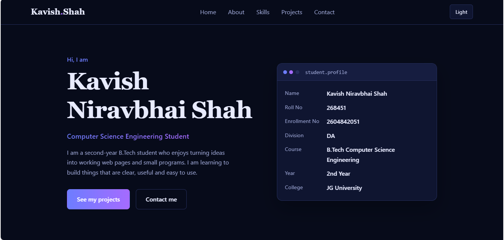

# Kavish_Shah_268451_Portfolio

A responsive personal portfolio website for **Kavish Niravbhai Shah**, built for the Web Technology assignment using only HTML5, CSS3 and vanilla JavaScript.

- **Roll No:** 268451
- **Enrollment No:** 2604842051
- **Course:** B.Tech Computer Science Engineering, 2nd Year
- **College:** JG University

## Technologies Used

- HTML5
- CSS3 (Flexbox, Grid, custom properties, media queries)
- Vanilla JavaScript (no frameworks or libraries)

## Features

- Sections: Home, About Me, Skills, Projects, Contact
- Dark mode / light mode toggle (remembers your choice)
- Responsive navbar with mobile open/close menu
- Contact form validation with error messages and success feedback
- Smooth scrolling and hover effects on cards and buttons
- Responsive layout for mobile, tablet and laptop screens

## Project Structure

```
Kavish_Shah_268451_Portfolio/
├── index.html
├── style.css
├── script.js
├── README.md
└── screenshot.png   (add this yourself)
```

## How to Run

1. Download or clone this repository.
2. Keep all files in the same folder.
3. Double-click `index.html` to open it in any web browser.

## Screenshot



**To add your screenshot:**
1. Open the website in your browser and take a screenshot.
2. Save it as `screenshot.png`.
3. Upload it to the repository root, next to `index.html`.

## Deploy with GitHub Pages

1. Open the repository on GitHub and go to **Settings > Pages**.
2. Under **Build and deployment**, set Source to **Deploy from a branch**.
3. Select branch **main** and folder **/ (root)**, then click **Save**.
4. After a minute, your site is live at `https://YOUR-USERNAME.github.io/Kavish_Shah_268451_Portfolio/`.

## Author

Kavish Niravbhai Shah, JG University
